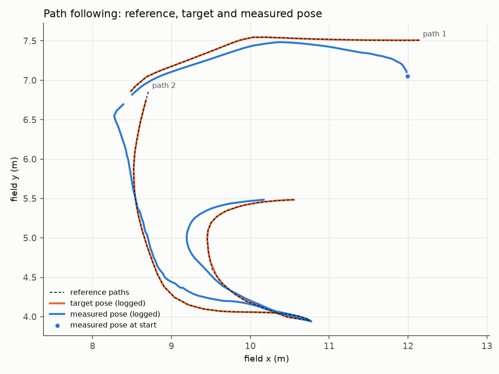
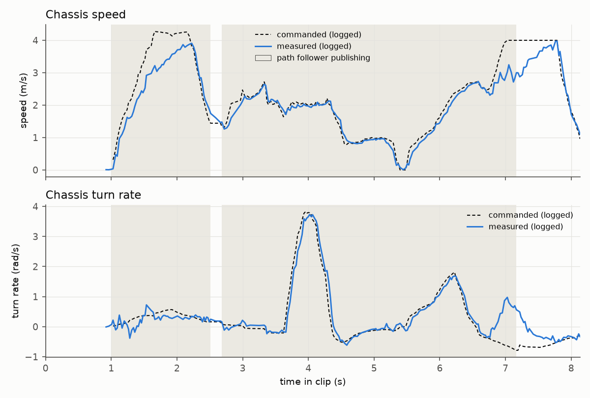

# control/chassis: swerve drive and autonomous path following

No video of this run exists; the recording below is the only record of it.

## What it does

It drives the robot's swerve base. A chassis command (a velocity across the field and a turn
rate, from the driver or, in autonomous, from a path follower) becomes a wheel speed and a
steering angle for each of the four swerve modules, and the modules' measured states become the
chassis velocity the rest of the robot reads. In autonomous, a path follower turns a planned path
and the robot's pose into that command.

## Why it exists

Every other mechanism rides on the chassis. The turret aims from it while it drives, and the
whole-body controller plans the arm and the base together. Both depend on the base doing what it
was asked, so how closely the chassis follows its command and its path is the floor for what they
can achieve.

## How it works

Cascaded velocity and heading loops, with feedforward, run on the swerve modules: the chassis
command is split into per-module targets, and each module tracks its target. The chassis is the
base the turret and the whole-body controller sit on, and it is driven through the same IO layer as
the other mechanisms (see `sim-io-layer`), so the same code drives the real modules and the
simulated ones. In autonomous, the open-source PathPlanner library follows the planned paths; it
reads the robot's pose and produces the chassis command.

## Interfaces

| In | Out |
|---|---|
| Chassis command: velocity and turn rate, from the driver or the path follower | Wheel speed and steering targets for the four modules, through the IO layer (see `sim-io-layer`) |
| Robot pose (from the pose estimator, see `state-estimation`), for path following | Measured chassis velocity from the modules (to the pose estimator and the turret) |

## How it was run

The drive ran every robot loop in the WPILib robot program on the roboRIO. The recording is an
autonomous routine of two paths.

## Replay

`replay/chassis-auto.csv` holds 8.1 s of an autonomous run in which the robot followed two planned
paths, 3.82 m and 7.67 m long, at up to 3.9 m/s. No video of this run exists. The source is
`run_1.wpilog`, a driver-station capture of the values the robot program and its path follower
published over NetworkTables, recorded on 2026-07-18. The path follower published from 11.06 s to
17.23 s after the capture's start; the window adds 1 s on each side (10.08 s to 18.21 s), converted
and renamed: 272 rows, 20 KB. There is one row per robot loop, one for each robot timestamp in the
capture. The capture records a value only when it changes, so the velocity columns hold their latest
value at that row's time; they are empty before their first value in the capture (0.92 s and
1.03 s into the clip). Values are written with 3 decimals.

The path follower publishes the measured pose it read and its target pose together, once per loop
in which it runs. A row holds the pair from its own loop, and the pose columns are empty in the
loops in which the follower published nothing: before, between and after the two paths.

| Columns | Unit | Logged as |
|---|---|---|
| `time_s` | s | Time since the window start |
| `path` | | The path being followed (1 or 2), in loops where the follower published; empty otherwise |
| `target_x_m`, `target_y_m`, `target_heading_deg` | m, deg | The follower's target pose, field frame |
| `measured_x_m`, `measured_y_m`, `measured_heading_deg` | m, deg | The measured pose the follower read (the robot's pose estimate), field frame |
| `cmd_vx_mps`, `cmd_vy_mps`, `cmd_omega_radps` | m/s, rad/s | The commanded chassis velocity, robot frame |
| `meas_vx_mps`, `meas_vy_mps`, `meas_omega_radps` | m/s, rad/s | The chassis velocity measured from the swerve modules, robot frame |

`replay/reference-path.csv` holds the two paths as the follower published them when each started:
`path`, `point`, `x_m`, `y_m` (field frame), 22 and 49 points, 1 KB.

Open either in any spreadsheet or plotting tool; plot `measured_y_m` against `measured_x_m` over
the reference path, or the commanded against the measured speed over `time_s`. It has no hosted
viewer link: the viewer opens MCAP files, and these are CSVs.

What to look for: the largest position error, 0.48 m, is at the first update, where the robot
started 0.48 m from the start of the first path; the median over the run is 0.13 m. On the first
path the command rises to 4.27 m/s while the measured speed reaches 3.91 m/s; on the second, 4.00
and 3.24 m/s. The measured pose is
the robot's own estimate, so these numbers are the follower's error as the robot saw it, not an
error against an external reference.

Read it with Python's standard library, from the repository root:

```python
import csv, math

rows = list(csv.DictReader(open("control/chassis/replay/chassis-auto.csv")))
fol = [r for r in rows if r["path"]]
err = [math.hypot(float(r["target_x_m"]) - float(r["measured_x_m"]),
                  float(r["target_y_m"]) - float(r["measured_y_m"])) for r in fol]
print(f"{len(rows)} rows, {len(fol)} follower updates; "
      f"position error RMS {math.sqrt(sum(e * e for e in err) / len(err)):.3f} m")
```

### Analysis

`replay/analyze_chassis.py` reads the two CSVs' logged columns and nothing else: the follower's
target pose and the measured pose it read, the commanded and measured chassis velocity, and the
reference path points. It runs no controller and no path follower. It needs only numpy and
matplotlib. From the repository root:

```sh
pip install -r requirements.txt     # numpy, matplotlib (mcap-ros2-support is not needed here)
python control/chassis/replay/analyze_chassis.py     # --log <csv>, --path <csv>, --out <dir>, --help
```

Output (0.5 s):

```
clip: chassis-auto.csv   272 rows over 8.13 s
path following: 2 paths (3.82 m + 7.67 m), 204 follower updates from 1.01 s to 7.17 s (6.16 s)
position error (target - measured, same loop): RMS 0.227 m, max 0.482 m at 1.01 s, median 0.130 m
heading error: RMS 7.28 deg, max 16.71 deg
velocity error while following (|v_cmd - v_meas|, 203 rows with both logged): RMS 0.439 m/s; turn rate RMS 0.365 rad/s
measured speed up to 3.91 m/s while following (3.98 m/s over the clip); commanded up to 4.27 m/s while following
wrote control/chassis/replay/replay_out/path.png
wrote control/chassis/replay/replay_out/velocity.png
```

The position and heading errors compare the target pose and the measured pose of the same loop.
The velocity error is over the follower's loops in which both velocities were logged.





Recordings © Zile Liao: they may be viewed and analysed, not redistributed. The scripts and text
are MIT-licensed with the rest of the repository.

## Status

**Status: log + measured numbers.** The drive's source is not in this repository. The numbers
above are read from the recording by `replay/analyze_chassis.py`. Tracking against an external
reference (motion capture or a field-measured pose) was not measured: the measured pose is the
robot's own estimate.

Replay data: `replay/chassis-auto.csv` and `replay/reference-path.csv` (converted from a
driver-station capture; not the full capture).

## Credits

Credits: to be confirmed by the author.
