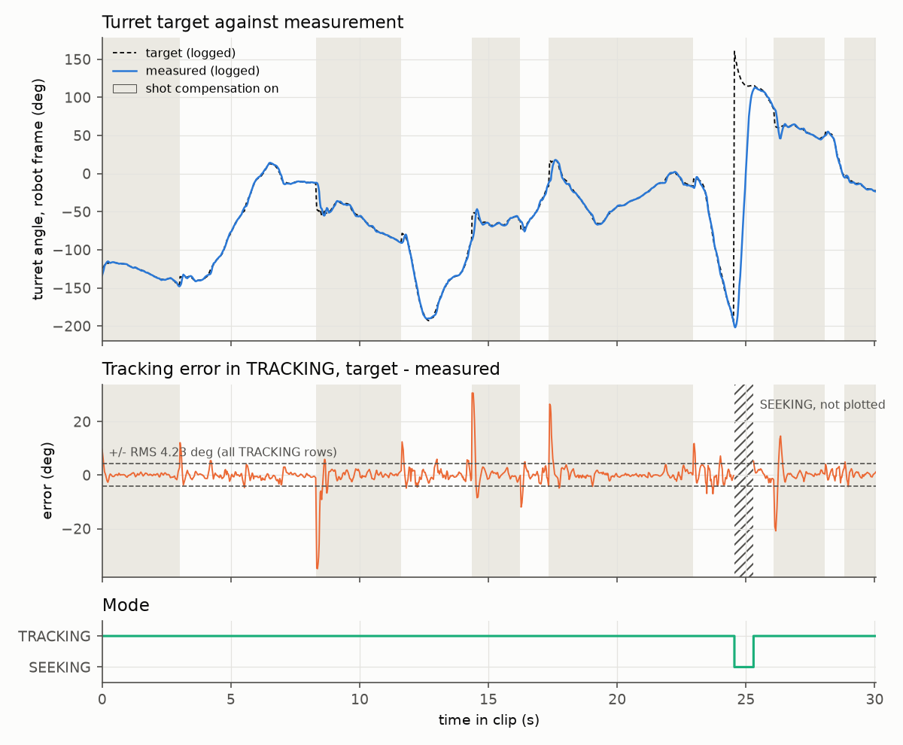
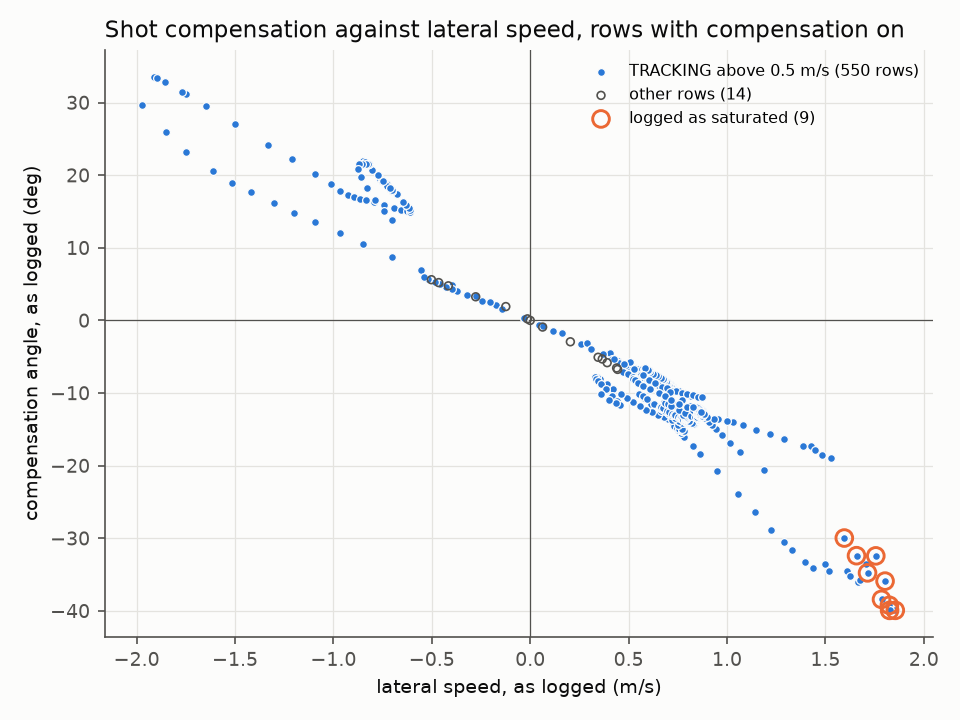

# control/turret-2026: turret aiming cascade and shoot-on-the-move compensation

Shown in motion on my project site: https://mai961.github.io/#shoot-on-the-move (that clip and
the recording below are from different runs).

## What it does

It points a shooter turret at a target while the robot drives. A shot solution turns the robot's
position and velocity into where to aim and how hard to shoot, so that a ball fired from a moving
robot still arrives on target. An aiming controller then drives the turret to that angle. It is a
cascade: an outer loop in the robot program turns the angle error into a velocity command every
20 ms, with feedforward, and the motor controller's own velocity loop tracks that command.

## Why it exists

A plain position PID on a turret either lags a moving target or overshoots on large moves. The
source code comments record what the logs showed: the robot loop ran slower than its nominal 20 ms,
the aim target lagged the real heading, and overshoots came from arriving at the target too fast.
The controller's design answers those findings. The shot compensation exists because a ball keeps
the robot's velocity. Driving toward or across the line of sight moves where it lands, so a table
built for a standing robot is not enough.

## How it works

The aiming loop is a cascade with feedforward: the robot program's outer loop turns the angle error
into a velocity command, a large move and fine tracking are handled in separate modes, and the
motor controller's velocity loop closes the inner loop. The feedforward takes out what the outer
loop can predict, such as the chassis turning under the turret and a cable spring that pulls the
turret toward zero. The shot solution compensates for the robot's own velocity at the moment of
release, so the aim and the shot strength account for the motion the ball inherits.

## Interfaces

| In | Out |
|---|---|
| Robot pose and velocity (from the pose estimator, see `state-estimation`) | Turret yaw target |
| Commanded and measured chassis turn rate | Hood angle and ball exit speed (to the shooter) |
| Turret position and velocity from `MotorIO` (see `sim-io-layer`) | Velocity setpoint and feedforward volts to `MotorIO` |

## How it was run

The controller and the shot solution ran every 20 ms in the robot program on the roboRIO. The
turret's velocity loop ran on its TalonFX motor controller. The gains are live-tunable parameters,
and they were tuned on a bench and from logs of recorded driving sessions.

## Replay

`replay/turret-shoot-30s.csv` holds 30 s of the turret tracking its target while the robot drives
at up to 3.5 m/s and the driver switches the shot compensation on and off. It is not from the same
run as the clip on the project site: no recorded log covers that clip. The source is
`run_8.wpilog`, a driver-station capture of the values the robot program published over
NetworkTables (its AdvantageKit outputs), recorded on 2026-07-18. The window is 1.80 s to 31.84 s
after the capture's start, converted and renamed: 1,010 rows, 73 KB. There is one row per robot
loop, one for each robot timestamp in the capture. The capture records a value only when it
changes, so each column holds its latest value at that row's time; the values that had not
changed since the previous capture file (the turret mode, and the compensation switch, off) are
carried over from that file. Values are written with 3 decimals.

| Columns | Unit | Logged as |
|---|---|---|
| `time_s` | s | Time since the window start |
| `turret_mode` | | `SEEKING` or `TRACKING` |
| `target_angle_robot_deg`, `measured_angle_robot_deg` | deg | The turret's target and measured angle, robot frame |
| `aim_error_abs_deg` | deg | The absolute aim error |
| `chassis_vx_mps`, `chassis_vy_mps`, `chassis_omega_radps` | m/s, rad/s | Measured chassis velocity from the swerve modules, robot frame |
| `compensation_enabled` | 0/1 | Whether the shot compensation was on |
| `compensation_angle_deg` | deg | The compensation angle the shot solution applied; logged only while the compensation is on, empty otherwise |
| `lateral_speed_mps` | m/s | The robot's speed across the line to the target, as the shot solution logged it; only while the compensation is on, empty otherwise |
| `compensation_saturated` | 0/1 | The shot solution's flag for a compensation at its limit |
| `shooting` | 0/1 | The drive's shooting flag |

Open it in any spreadsheet or plotting tool; plot `target_angle_robot_deg` and
`measured_angle_robot_deg` against `time_s`, or `compensation_angle_deg` against
`lateral_speed_mps`. It has no hosted viewer link: the viewer opens MCAP files, and this is a CSV.

What to look for: across lateral speeds from −1.971 to +1.855 m/s, the logged compensation angle
ranged from −39.9° to +33.6°. The compensation was on in 6 periods, 17.0 s in all, 16.65 s of it
while the turret was tracking and the robot moved faster than 0.5 m/s. Every tracking error above
10° falls within 0.3 s after the compensation was switched on or off, when the target steps by the
compensation angle. From 24.55 s to 25.29 s the turret is in `SEEKING`: the robot-frame target
jumps from −194° to +160°, and the turret swings across, from −200° to +110°.

Read it with Python's standard library, from the repository root:

```python
import csv

rows = list(csv.DictReader(open("control/turret-2026/replay/turret-shoot-30s.csv")))
on = [r for r in rows if r["compensation_enabled"] == "1"]
lat = [float(r["lateral_speed_mps"]) for r in on]
ang = [float(r["compensation_angle_deg"]) for r in on]
print(f"{len(rows)} rows, {len(on)} with compensation on: "
      f"lateral speed {min(lat):+.2f} to {max(lat):+.2f} m/s, "
      f"compensation angle {min(ang):+.1f} to {max(ang):+.1f} deg")
```

### Analysis

`replay/analyze_turret.py` reads the CSV's logged columns and nothing else: target and measured
angle, mode, measured chassis velocity, the compensation switch, and the compensation angle,
lateral speed and saturation flag the robot logged. It runs no control law and no shot solution.
It needs only numpy and matplotlib. From the repository root:

```sh
pip install -r requirements.txt     # numpy, matplotlib (mcap-ros2-support is not needed here)
python control/turret-2026/replay/analyze_turret.py     # --log <csv>, --out <dir>, --help
```

Output (0.6 s):

```
clip: turret-shoot-30s.csv   1010 rows over 30.0 s (SEEKING 24, TRACKING 986)
chassis up to 3.52 m/s (measured), above 0.5 m/s on 94 % of the rows
shot compensation on in 6 periods, 17.04 s in all; on while TRACKING above 0.5 m/s: 16.65 s (550 rows)
  over those rows: lateral speed -1.971 to +1.855 m/s, compensation angle -39.93 to +33.59 deg (both as logged)
  compensation logged as saturated from 8.45 s to 8.67 s (9 rows)
tracking error (target - measured): RMS 5.17 deg while compensating (550 rows), RMS 4.23 deg over all TRACKING rows (986)
wrote control/turret-2026/replay/replay_out/tracking.png
wrote control/turret-2026/replay/replay_out/compensation_vs_lateral_speed.png
```

"While compensating" means the rows with the compensation on, the turret in `TRACKING` and the
robot faster than 0.5 m/s. The tracking error there is larger than over all `TRACKING` rows: the
largest errors follow the compensation being switched on, when the target steps by the
compensation angle. The plot below shows the steps, with the compensation periods shaded.





Recordings © Zile Liao: they may be viewed and analysed, not redistributed. The scripts and text
are MIT-licensed with the rest of the repository.

## Status

**Status: recording + measured numbers.** The controller's and the shot solution's source are not
in this repository. The numbers above are read from the recording by `replay/analyze_turret.py`.
Latency and hit rate at the target were not measured.

Replay data: `replay/turret-shoot-30s.csv` (converted from a driver-station capture of the values
the robot published; not the full capture).

## Credits

Written by Zile Liao, with contributions from teammates: 24 of 37 non-merge commits on
`TurretSubsystem.java` and `ShotCalculator.java` are his
(`git log --no-merges --format=%an -- <files>` in the source repository). The shot-compensation
analysis document (kept in the private companion) is his alone (3 of 3 commits).
