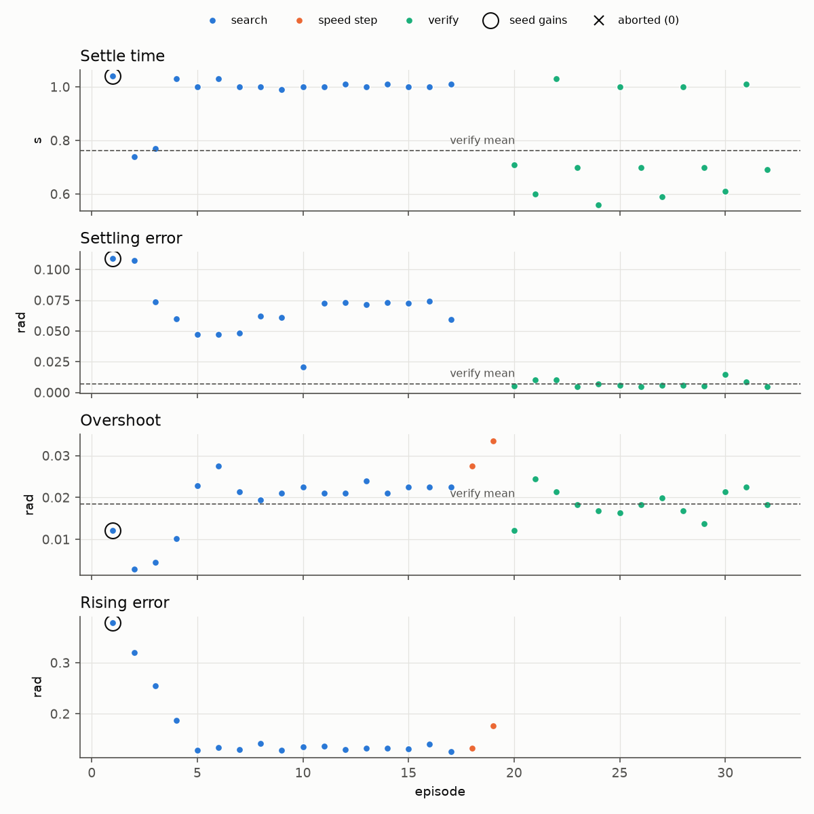

# llm-tuning-agent: PID tuning on a test bench, steered by a coding agent

Shown in motion on my project site: https://mai961.github.io/#auto-tuning

## What it does

It tunes the position controller (PID and feedforward terms) of one robot arm joint on a test
bench. A ROS 2 node on the bench computer runs the experiments: it sets gains, drives the joint
through a test trajectory, scores the result, and aborts if anything looks unsafe. The decisions
in between, such as which gain to sweep next and over what range, and when to stop, are made by a
coding agent following a written procedure.

There is no language-model API client in this code. The agent is a coding assistant running a
documented procedure against the bench node's parameter interface: it sends one directive at a
time and reads back a result file.

## Why it exists

A blind grid or greedy search over gains tends to chase noisy minima into extreme values. In the
procedure's own words: "you don't replace the search, you **point it**". The deterministic sweep
stays in code that enforces the limits. The reasoning about traces, such as recognizing that
overshoot at the stop calls for acceleration feedforward rather than more damping, is done by the
agent, and every move has a stated reason.

## How it works

The bench node runs gain experiments inside hard limits: every gain has a bounded range, and an
episode that leaves the joint's safe envelope is aborted and can never win a sweep. A coding agent
chooses the next sweep and when to stop, by reading each result and the traces behind it. Safety
stays in code: whatever the agent sends, the node enforces the bounds and the abort guards. When the
agent is done, the node writes the tuned gains to a file, and a human moves them into the robot's
configuration.

## Interfaces

The agent talks to the bench node through one ROS parameter and a result file. The bench node
reaches the joint on the roboRIO through NetworkTables 4 (via `nt-bridge`): it sends gains and a
command, and receives the joint's telemetry.

## How it was run

The node ran on a bench computer wired to a roboRIO that drove one arm joint at a time (shoulder
or forearm). A coding-agent session drove the loop over SSH, following the procedure. The procedure
records a provisional result for the shoulder from a session on 2026-06-30 (loaded arm, unstable
mount), with a note to re-validate it on a rigid mount.

## Replay

One bench session: 32 experiments; settling time 1.04 → 0.76 s; steady (settling) error 0.109 →
0.0071 rad; overshoot 0.0122 → 0.0185 rad, which rose. Each pair is the episode with the starting
gains against the mean of the 13 verify episodes with the final gains.

`replay/shoulder-session-episodes.csv` is a bench tuner session log, not a robot recording: the
measured outcome of every episode of one shoulder tuning session on the test bench, on 2026-06-29,
about 3.5 minutes long. It was converted from the tuner node's text log, one row per episode, 32
rows, 1 KB. The tuner ran 17 search episodes in four sweeps, each sweep over one gain around the
starting gains, then two speed steps that ran the converged gains at a rising trajectory speed, then
13 verify episodes with the final gains. No episode was aborted. The gain values, the gain bounds
and the abort limits are left out; `gain_set` only marks which episodes ran the starting and the
final gains. The log does not record who chose each sweep: it holds the tuner's episodes and
results, not the decisions of the coding agent described above, if any were made in this session.

| Columns | Unit | Logged as |
|---|---|---|
| `episode` | | Episode number, in the order the tuner logged them |
| `phase` | | `search`, `speed` (speed step) or `verify` |
| `sweep` | | Sweep number (1-4) for search episodes; empty otherwise |
| `gain_set` | | `seed` for the episode with the starting gains, `final` for the episodes with the final gains; empty otherwise |
| `aborted` | 0/1 | Whether the tuner aborted the episode |
| `overshoot_rad` | rad | Overshoot |
| `settle_time_s` | s | Settle time; not logged for speed steps |
| `settling_error_rad` | rad | Settling error; not logged for speed steps |
| `rising_error_rad` | rad | Error while the joint is moving; not logged for verify episodes |

Errors are in radians of shoulder angle: the tuner computes them from the joint's reference and
measured position, which the robot sends in the joint's mechanism units (radians for the
shoulder). An empty cell is a value the tuner did not log for that kind of episode.

Read it with Python's standard library, from the repository root:

```python
import csv

rows = list(csv.DictReader(open("llm-tuning-agent/replay/shoulder-session-episodes.csv")))
verify = [float(r["settle_time_s"]) for r in rows if r["phase"] == "verify"]
print(f"{len(rows)} episodes; verify settle time mean {sum(verify) / len(verify):.2f} s")
```

### Analysis

`replay/analyze_tuning.py` reads the CSV's columns and nothing else. It counts the experiments,
compares the seed episode with the mean of the verify episodes, and prints the search episode that
ran the final gains. It runs no tuner, no cost function and no controller. It needs only numpy and
matplotlib. From the repository root:

```sh
pip install -r requirements.txt     # numpy, matplotlib (mcap-ros2-support is not needed here)
python llm-tuning-agent/replay/analyze_tuning.py     # --log <csv>, --out <dir>, --help
```

Output (0.5 s):

```
session: shoulder-session-episodes.csv   32 episodes: 17 search (4 sweeps), 2 speed steps, 13 verify; 0 aborted
seed (episode 1) against the mean of the 13 verify episodes (final gains):
  settle time     1.04 s -> 0.76 s   (fell)
  settling error  0.1090 rad -> 0.0071 rad   (fell)
  overshoot       0.0122 rad -> 0.0185 rad   (rose)
  rising error    0.378 rad -> 0.133 rad   (verify episodes do not log it; episode 18, the first speed step with the final gains)
final gains in a search episode (episode 17, the same episode type as the seed): settle time 1.01 s, settling error 0.0595 rad, overshoot 0.0225 rad, rising error 0.127 rad
wrote llm-tuning-agent/replay/replay_out/episodes.png
```

The overshoot rose: against the seed episode, the verify episodes settle sooner and closer, and
overshoot more. The verify episodes log fewer outcomes than the search episodes and may not be the
same test: with the same final gains, the last search episode logged a settle time of 1.01 s and a
settling error of 0.0595 rad, against 1.04 s and 0.1090 rad for the starting gains in the same
kind of episode. The verify episodes do not log the rising error, so its "after" value comes from
the first speed step, which ran the final gains.



Recordings © Zile Liao: they may be viewed and analysed, not redistributed. The scripts and text
are MIT-licensed with the rest of the repository.

## Status

**Status: log + measured numbers.** The bench node's and the procedure's source are not in this
repository. The numbers above are read from the session log by `replay/analyze_tuning.py`. Tuning
quality compared with manual tuning: not measured. Which episodes the coding agent chose: not
recorded in the log.

Replay data: `replay/shoulder-session-episodes.csv` (converted from a bench tuner session log;
gains and limits removed).

## Credits

Written by Zile Liao: all commits in the source repository are his
(`git log --no-merges --format=%an`). The procedure is written for, and was run by, an AI coding
assistant, as described above.
