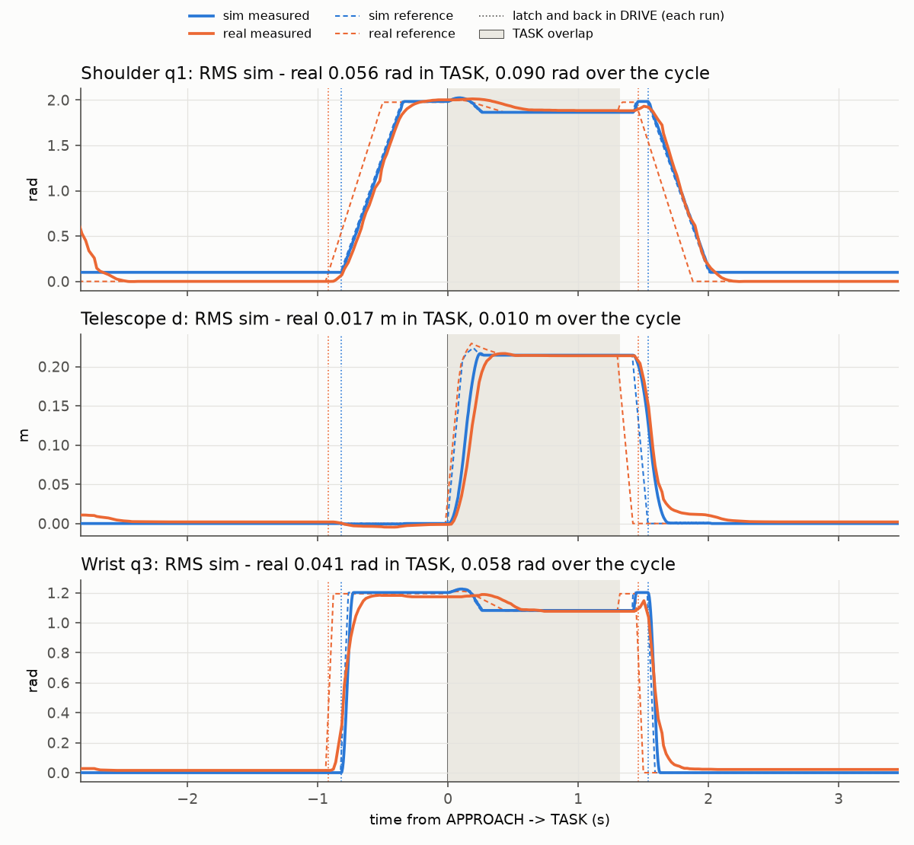

# sim-io-layer: same controller, two backends

[](https://replay-viewer-e62.pages.dev/?ds=remote-file&ds.url=https%3A%2F%2Fpub-0f92a4b175d3420290d73d6c2242fb57.r2.dev%2Fsim-wholebody%2Fsim-cycle.mcap&layoutUrl=https%3A%2F%2Fpub-0f92a4b175d3420290d73d6c2242fb57.r2.dev%2Fsim-wholebody%2Ffoxglove-layout.json) **[▶ Open in viewer](https://replay-viewer-e62.pages.dev/?ds=remote-file&ds.url=https%3A%2F%2Fpub-0f92a4b175d3420290d73d6c2242fb57.r2.dev%2Fsim-wholebody%2Fsim-cycle.mcap&layoutUrl=https%3A%2F%2Fpub-0f92a4b175d3420290d73d6c2242fb57.r2.dev%2Fsim-wholebody%2Ffoxglove-layout.json)**

The project site, https://mai961.github.io/, shows a MuJoCo rendering of the logged cycles
(kinematic replay of logged joint states; MuJoCo is not in the control loop).

## What it does

The IO layer is an interface with two backends: TalonFX motor controllers over CAN, and a
kinematic WPILib simulation. The whole-body controller and phase machine run unchanged against the
simulated robot: the robot program runs in WPILib simulation and talks to the controller over the
same UDP bridge on loopback, with a simple chassis integrator standing in for localization. What is
swapped is the backend, not the controller.

Every mechanism talks to its motor through one interface, `MotorIO`. On the robot that interface is
backed by a CTRE TalonFX motor controller (`MotorIOTalonFX`); in simulation, by a kinematic model
(`MotorIOSim`). The swerve drive modules have their own interface, with an equally simple simulated
version (`SwerveModuleIOSimpleSim`).

## Why it exists

The robot program has to run in WPILib simulation for testing, and its match logs have to show
exactly what the code saw. Putting all hardware access behind an IO interface, with one inputs
object that is read once per loop and logged, gives both. The interface's comment sets the ownership
rule (paraphrased here): the subsystem owns its IO and logs its inputs every loop. The kinematic
model was chosen on purpose; its class comment reads: "A simple kinematic motor simulation that
moves directly according to its limits. This avoids the complexity and potential bugs of a full
physics simulation when realism is not required."

## How it works

```
 subsystem (turret, shooter, ...) ──► MotorIO ──┬── MotorIOTalonFX: TalonFX runs the closed loops
        ▲                                       └── MotorIOSim:     kinematic model in the robot loop
        └── MotorInputs (read once per loop, logged by AdvantageKit)

 swerve drive ──► SwerveModuleIO ──► SwerveModuleIOSimpleSim: module is in its commanded state
```

The real or simulated implementation is picked once, when the robot program builds the
subsystem. From the source (`RobotContainer.java`):

```java
isReal
        ? new MotorIOTalonFX(TurretConfig.TURRET_CONFIG)
        : new MotorIOSim(TurretConfig.TURRET_CONFIG),
```

1. `MotorIO.java` is the contract: read inputs, and set voltage, a velocity with feedforward volts,
   or a profiled position. All in mechanism units.
2. `MotorInputs.java` holds the values read each loop. `@AutoLog` makes AdvantageKit log every
   field.
3. `MotorSubsystem.java`: `periodic` reads the IO once and logs it, and commands only call the IO.
4. `MotorIOTalonFX.java` sets the gear ratio on the controller, lowers the status-signal rate to
   100 Hz to save CAN bandwidth, and sends velocity and Motion Magic requests that the controller
   runs itself.
5. `MotorIOSim.java`: `readInputs` advances a kinematic model. Voltage maps linearly to speed, a
   velocity setpoint is reached at once (capped at the motor's free speed), and a position setpoint
   follows a trapezoid profile.
6. `SwerveModuleIOSimpleSim.java`: each simulated module is exactly in its commanded state (wheel
   speed, steering angle), and drive distance is integrated from the speed. The library also has a
   heavier variant built on WPILib's `DCMotorSim` (motor model, inertia, gear ratio), but the robot
   program wired in this simple one.

## Interfaces

| Method | Real (TalonFX) | Simulated |
|---|---|---|
| `readInputs(MotorInputs)` | reads the controller's status signals | reports the kinematic state; current is 0 |
| `setVoltage(volts)` | `VoltageOut` | speed = volts / 12 x free speed |
| `setVelVoltSetpoint(velocity, ffVolts)` | `VelocityVoltage` with feedforward, on the controller | velocity set directly; feedforward ignored |
| `setMotionMagicSetpoint(position)` | `MotionMagicVoltage`, profiled on the controller | trapezoid profile in the model |

## How it was run

The robot program's motor subsystems (turret, shooter, hood, intake and others) used `MotorIO`. On
the robot the TalonFX implementation ran. In WPILib simulation, the same program ran with
`MotorIOSim` and `SwerveModuleIOSimpleSim`, and the coprocessor stack connected to it over the UDP
bridge on loopback.

For the recording below, the whole-body controller and phase machine (see
`control/wholebody-2026`) ran against the simulated robot on one computer, with a simple chassis
integrator in place of the localizer. The run used the same goal name and hold time as the real run
in `control/wholebody-2026`, but the current goal set places that goal 1 m further along x, so the
simulated robot's start was shifted by 1 m to keep the approach geometry.

## Replay

`replay/sim-cycle.mcap` holds one full DRIVE → APPROACH → TASK → RETRACT → DRIVE cycle of the
whole-body controller against the simulated robot, with DRIVE before and after it: the same
controller and goal (`rear_2`) as the real cycle in
[`control/wholebody-2026`](../control/wholebody-2026/). It was recorded on 2026-10-19 and cut to
the cycle, 6.35 s, and renamed: 16 topics, 7,278 messages, 0.33 MB.

| Topic | Messages | Content |
|---|---|---|
| `/wholebody/references` | 1,271 | Coprocessor → simulated robot: joint targets for the three joints |
| `/wholebody/measured` | 1,271 | Simulated robot → coprocessor: measured joints, same order |
| `/wholebody/goal` | 1,271 | The goal the operator holds (`""` or `rear_2`) |
| `/wholebody/status` | 1,271 | The phase (1-4 = DRIVE…RETRACT) and task errors |
| `/wholebody/event` | 6 | Phase transitions and goal changes as JSON |
| `/wholebody/base_ref` | 284 | The TASK base plan, field frame |
| `/wholebody/goal_base`, `/wholebody/task_anchor` | 448, 284 | The selected goal, and the target the QP works toward in TASK, in the base frame |
| `/wholebody/goals_field` | 3 | The goal set in the field frame |
| `/odin_tree/field_base` | 317 | The field pose the state machine reads; here from the chassis integrator, not a localizer |
| `/viz/arm` | 96 | The arm drawn in the robot's base frame (`foxglove_msgs/SceneUpdate`) |
| `/viz/robot_field` | 96 | The chassis outline, the planned chassis and a ghost arm, in the field frame |
| `/viz/field` | 3 | The field for the 3D view |
| `/viz/field_base_path` | 23 | Recorded path, cropped to the clip window (poses before the window removed) |
| `/viz/field_base_pose` | 317 | The robot's field pose for the 3D view |
| `/tf` | 317 | Derived: `field` to `odom` to `base`, made from `/odin_tree/field_base` when the clip was cut, for display only |

`/tf` is derived, as its row says (its channel metadata carries a `derived` note), and
`/viz/field_base_path` is cropped (a `cropped` note). All other messages are byte-for-byte as
recorded.

To open it, run `ros2 bag play sim-io-layer/replay` (ROS 2 Jazzy reads MCAP out of the box; older
distributions need the `rosbag2_storage_mcap` plugin), or open the `.mcap` file directly in
Foxglove Studio. Open it in the browser:
https://replay-viewer-e62.pages.dev/?ds=remote-file&ds.url=https%3A%2F%2Fpub-0f92a4b175d3420290d73d6c2242fb57.r2.dev%2Fsim-wholebody%2Fsim-cycle.mcap&layoutUrl=https%3A%2F%2Fpub-0f92a4b175d3420290d73d6c2242fb57.r2.dev%2Fsim-wholebody%2Ffoxglove-layout.json
(Lichtblick, an open-source build of Foxglove Studio, loads the clip and
`replay/foxglove-layout.json` from the project's file mirror; no sign-in). Or open the local file in
Foxglove Studio and import `replay/foxglove-layout.json`. The layout is the one of
`control/wholebody-2026`: three plots of reference against measured joint position (shoulder,
telescope, wrist) and the phase on the left, one 3D view of the arm and the chassis on the field on
the right, and the phase events across the bottom.

What to look for: the controller ran unchanged, and the cycle has the same phases as the real one.
APPROACH took 0.820 s against 0.920 s on the real robot, TASK 1.420 s against 1.320 s, and the whole
cycle from the latch back to DRIVE 2.355 s against 2.380 s. The simulated shoulder sits 0.1 rad
higher in DRIVE than the real one: the current stow posture differs by 0.1 rad on the shoulder,
which shows as a steady offset in DRIVE. The simulated plant is kinematic, so it tracks almost
perfectly: in TASK the simulated shoulder and wrist stay within 0.004 rad RMS of their references,
against 0.043 and 0.027 rad on the real robot. The telescope's reference steps faster than the
simulated motor moves, so it trails it (0.035 m RMS, against 0.053 m on the real robot).

Read it without ROS (`pip install mcap-ros2-support`), from the repository root:

```python
import json
from mcap_ros2.reader import read_ros2_messages

BAG = "sim-io-layer/replay/sim-cycle.mcap"
T0 = 1792426053211485017  # window start in ns (starting_time in replay/metadata.yaml)
for m in read_ros2_messages(BAG, topics=["/wholebody/event"]):
    print(f"{(m.log_time_ns - T0) * 1e-9:6.3f} s  {json.loads(m.ros_msg.data)}")
```

### Analysis

`replay/analyze_sim_vs_real.py` reads the measured and reference joints and the phase events of
this clip and of the real cycle in `control/wholebody-2026`, at their log times, and nothing else.
It shifts each run so that its APPROACH → TASK event is at t = 0, samples both on a common 5 ms
grid by linear interpolation, and compares them. It runs no controller, no solver and no plant
model. From the repository root:

```sh
pip install -r requirements.txt
python sim-io-layer/replay/analyze_sim_vs_real.py     # --sim <mcap>, --real <mcap>, --out <dir>, --help
```

Output (0.6 s):

```
sim: sim-cycle.mcap   goal rear_2, 1271 measured-joint messages (200 Hz), APPROACH -> TASK at 2.819 s
real: wholebody-cycle-shop.mcap   goal rear_2, 280 measured-joint messages (44 Hz), APPROACH -> TASK at 2.919 s
phase durations (s)      sim     real
  APPROACH               0.820    0.920
  TASK                   1.420    1.320
  RETRACT                0.115    0.140
  latch -> DRIVE         2.355    2.380
measured joints, RMS of sim - real, both aligned at APPROACH -> TASK:
  TASK overlap (+0.00 s to +1.32 s): q1 0.0559 rad, d 0.0170 m, q3 0.0414 rad
  full cycle (-2.82 s to +3.46 s): q1 0.0901 rad, d 0.0096 m, q3 0.0580 rad
tracking in TASK overlap, RMS of measured - reference:
  sim: q1 0.0036 rad, d 0.0346 m, q3 0.0035 rad
  real: q1 0.0429 rad, d 0.0530 m, q3 0.0275 rad
wrote sim-io-layer/replay/replay_out/sim_vs_real.png
```

The TASK overlap is the shorter of the two TASK phases. The full cycle reaches from 2 s before the
later latch to 2 s after the earlier return to DRIVE, within both recordings. Over the full cycle
the stow offset and the different phase timing add to the difference.



Recordings © Zile Liao: they may be viewed and analysed, not redistributed. The scripts and text
are MIT-licensed with the rest of the repository.

## Status

**Status: recording + viewer + measured numbers.** All files except `MotorInputs.java` (a faithful
excerpt) are simplified from the source. They need WPILib, CTRE Phoenix 6 and AdvantageKit, and
will not compile on their own. The numbers above are read from the two recordings by
`replay/analyze_sim_vs_real.py`. Fidelity of the simulated plant to the real mechanism beyond these
two cycles: not measured.

Replay data: `replay/sim-cycle.mcap` (cut from a recorded bag of the simulation run; not the full
bag).

## Credits

Written by Zile Liao, with contributions from teammates: 32 of 52 non-merge commits on the excerpted
files are his (`git log --no-merges --format=%an -- <files>` in the source repository).
